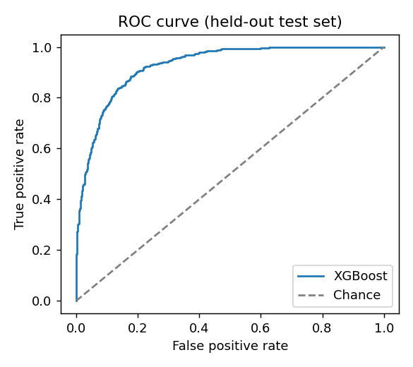
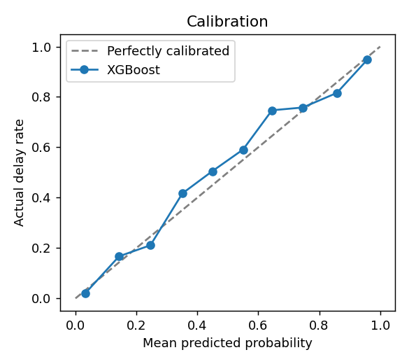
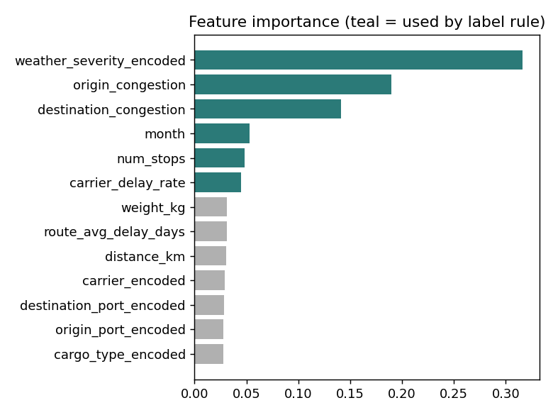

# ML Evaluation — Delay-Risk Model

> Generated by `ml/evaluate_model.py` (n = 10,000, fixed seeds). Re-run it to reproduce every number below.

## Read this first: what these numbers do and do not prove

The training data is **synthetic**. Delay labels are produced by a known rule over congestion, weather, carrier delay rate, stops and season, plus Gaussian noise. So these results show that the pipeline (feature encoding → training → serving → explanation) works and that the model recovers the rule. They do **not** show how well it would predict delays on real shipments. Validating on real port/carrier data is the main piece of future work.

## 1. Cross-validated model comparison (5-fold, stratified)

| Model               | Accuracy        | F1              | AUC-ROC         |
|:--------------------|:----------------|:----------------|:----------------|
| Logistic Regression | 0.7928 ± 0.0049 | 0.7373 ± 0.0060 | 0.8722 ± 0.0028 |
| Random Forest       | 0.8345 ± 0.0092 | 0.7814 ± 0.0116 | 0.9121 ± 0.0056 |
| XGBoost             | 0.8377 ± 0.0080 | 0.7890 ± 0.0107 | 0.9181 ± 0.0049 |

## 2. Oracle ceiling

The true generating rule, applied without the label noise it cannot see, scores:

| Accuracy | AUC |
|---|---|
| 0.8443 | 0.9260 |

No model can honestly beat this ceiling. The closer XGBoost sits to it, the more completely it has recovered the rule — and nothing more.

## 3. Feature-importance sanity check

| Feature                  |   Importance | Used by generator?   |
|:-------------------------|-------------:|:---------------------|
| weather_severity_encoded |       0.3164 | yes                  |
| origin_congestion        |       0.19   | yes                  |
| destination_congestion   |       0.1411 | yes                  |
| month                    |       0.0533 | yes                  |
| num_stops                |       0.048  | yes                  |
| carrier_delay_rate       |       0.0451 | yes                  |
| weight_kg                |       0.0314 | no                   |
| route_avg_delay_days     |       0.0309 | no                   |
| distance_km              |       0.0306 | no                   |
| carrier_encoded          |       0.0291 | no                   |
| destination_port_encoded |       0.0282 | no                   |
| origin_port_encoded      |       0.028  | no                   |
| cargo_type_encoded       |       0.0279 | no                   |

Importance on features the label rule ignores (weight, cargo, ports, carrier id, distance, route history): **20.6%** of total. On features it uses: **79.4%**. A model that learned the right structure should concentrate on the second group.

## 4. Calibration

Brier score: **0.1063** (lower is better; 0.25 is a coin-flip baseline).

| Predicted range   |   Samples |   Mean predicted |   Actual delay rate |
|:------------------|----------:|-----------------:|--------------------:|
| 0.0–0.1           |       714 |            0.032 |               0.02  |
| 0.1–0.2           |       198 |            0.143 |               0.167 |
| 0.2–0.3           |       128 |            0.246 |               0.211 |
| 0.3–0.4           |       120 |            0.351 |               0.417 |
| 0.4–0.5           |        99 |            0.449 |               0.505 |
| 0.5–0.6           |        88 |            0.55  |               0.591 |
| 0.6–0.7           |        83 |            0.645 |               0.747 |
| 0.7–0.8           |       124 |            0.746 |               0.758 |
| 0.8–0.9           |       141 |            0.858 |               0.816 |
| 0.9–1.0           |       305 |            0.958 |               0.948 |

## 5. Robustness

**Label noise** — trained on corrupted labels, tested on clean labels:

| Training labels flipped   |   Test accuracy |   Test AUC |
|:--------------------------|----------------:|-----------:|
| 0%                        |          0.8485 |     0.9281 |
| 5%                        |          0.839  |     0.9234 |
| 10%                       |          0.8385 |     0.9186 |
| 20%                       |          0.8135 |     0.8931 |

**Distribution shift** — same rule, but test shipments come from a more congested world than the training data:

| Test set            |   Delay rate |   Accuracy |    AUC |
|:--------------------|-------------:|-----------:|-------:|
| In-distribution     |        0.402 |     0.8323 | 0.9133 |
| Congested (shifted) |        0.7   |     0.8405 | 0.9073 |

## Charts

## Limitations (stated plainly)

- Synthetic labels: results are an upper bound on realistic performance.
- Port/carrier identity is label-encoded as integers; with real data a target or one-hot encoding should be compared.
- `predicted_delay_days` in the API is a heuristic, not a trained regressor.
- Per-shipment explanations use TreeSHAP contributions (log-odds); they explain the *model*, not causality in the real world.
